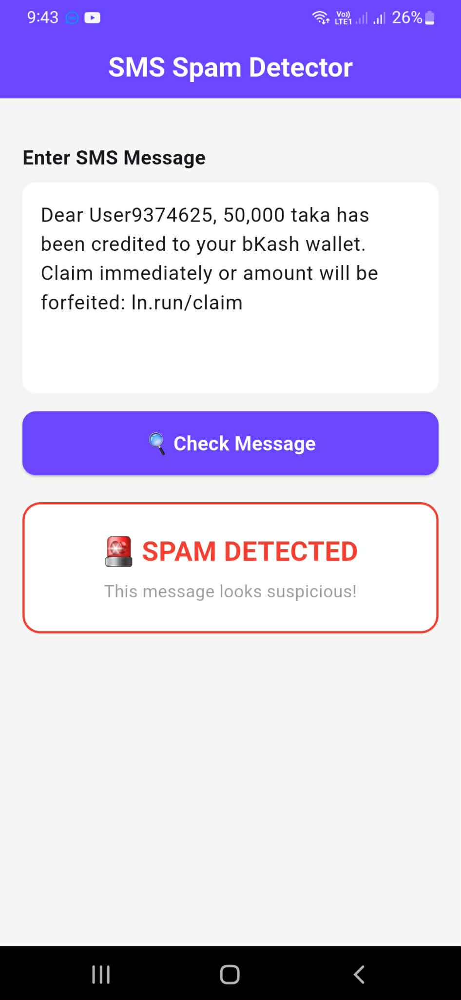

# Phishing SMS Detection in Bangladeshi Mobile Banking

<p align="center">
  <a href="https://www.youtube.com/shorts/Jll6J8PjA48">
    
  </a>
  <br><br>
  <a href="https://www.youtube.com/shorts/Jll6J8PjA48">
    
  </a>
</p>

Watch the 1-minute demo on YouTube.

Machine learning for detecting SMS phishing ("smishing") that imitates bKash, Nagad, and Rocket transaction messages, including code-mixed Bangla-English ("Banglish") text. Undergraduate thesis, Department of CSE, Notre Dame University Bangladesh (June 2026).

**Result:** 94.86% accuracy and 97% spam recall with a Hard Voting Ensemble; 100% spam recall on the test set with an added dual-gate detector (threshold 0.70).

## The problem
Older spam filters look for obvious keywords such as "prize" or "win". Mimicry attacks avoid them by copying the exact wording of real transaction alerts ("Cash In", "TrxID", "Success"), usually in Banglish. Public datasets are mostly English, so existing filters handle these messages poorly.

## What this repository contains
- The notebook with preprocessing, TF-IDF features, model training, and evaluation
- Plots and results used in the thesis
- Dataset information (see the Dataset section)

## Approach
1. **Preprocessing:** lowercasing, a custom regex filter that keeps Bangla Unicode (U+0980-U+09FF) and Latin text, numbers of six or more digits replaced with a `<NUM>` token, and whitespace normalization.
2. **Features:** TF-IDF with 1-3 grams (`max_features=10000`, `sublinear_tf=True`, `min_df=2`, `max_df=0.9`).
3. **Models:** a Hard Voting Ensemble of LinearSVC (C=0.8), Logistic Regression (C=0.8, balanced class weights), and Random Forest (200 trees, balanced class weights).
4. **Dual-gate detector:** a message is labeled safe only if the ensemble predicts Ham and a separate Logistic Regression model gives a Ham confidence of at least 0.70. Otherwise it is flagged as Spam. The aim is to avoid missing phishing messages.

All experiments use `random_state=42` and an 80/20 stratified split (58,114 training, 14,529 test messages).

## Results (test set of 14,529 messages)

**Hard Voting Ensemble**

| Accuracy | Spam precision | Spam recall | Spam F1 | Macro F1 |
|---|---|---|---|---|
| 94.86% | 90% | 97% | 93% | 95% |

Confusion matrix: 8,681 Ham correct, 562 Ham flagged as Spam, 185 Spam missed, 5,101 Spam caught.

**Base learners (Spam class)**

| Model | Accuracy | Precision | Recall | F1 |
|---|---|---|---|---|
| Calibrated SVM | 94.91% | 93.36% | 92.58% | 92.97% |
| Logistic Regression | 94.77% | 87.72% | 99.56% | 93.27% |
| Random Forest | 94.75% | 91.50% | 94.32% | 92.89% |

**Dual-gate detector (threshold 0.70)**

| Accuracy | Spam precision | Spam recall | Spam F1 |
|---|---|---|---|
| 94.62% | 87.13% | 100.00% | 93.12% |

The dual-gate detector gives up some precision to catch every phishing message in the test set. The Logistic Regression confidence model has an AUC of 0.995.

## Dataset
The dataset has 72,643 labeled messages (46,361 Ham, 26,282 Spam) in English, Bengali, and Banglish across bKash, Nagad, and Rocket. It combines messages collected from users, official message formats, a small set of manually written examples, and rule-based augmentation that creates realistic mimicry attacks. Phone numbers, transaction IDs, and OTPs were replaced with placeholders, and 124 exact duplicates were removed.

The full dataset is not published, because it contains user-contributed messages and was built with partner and institutional constraints. Each record has a binary label (Spam or Ham) and a message sub-category.

## Limitations
- Most phishing messages are generated through augmentation, not collected from real campaigns, so performance on new scam styles is untested.
- The 0.70 threshold was chosen by analyzing the test set, so the 100% recall figure is optimistic. It should be confirmed on a separate hold-out set.
- Logistic Regression alone scores about the same as the ensemble; the ensemble adds robustness, and Logistic Regression powers the second gate.
- The app is a prototype and has not been tested with real users.

## System demo
The trained model is served by a Flask API (hosted on Render) and used by a Flutter Android app. The user pastes a message, taps "Check Message", and gets a Spam or Safe verdict.

## Run the notebook
```bash
git clone https://github.com/hemal1020/mobile-banking-phishing-detection-bd.git
cd mobile-banking-phishing-detection-bd
pip install pandas numpy scikit-learn matplotlib jupyter
jupyter notebook
```
Open the main notebook and run the cells in order.

## Team
Md. Hemal Ahmed, Rejuana Azad, and Jan Jason Ralf. Supervisor: Md. Khorshed Alam, Lecturer, Department of CSE, Notre Dame University Bangladesh.

## Tech stack
Python, scikit-learn, pandas, NumPy, Jupyter Notebook, Flask, Flutter
